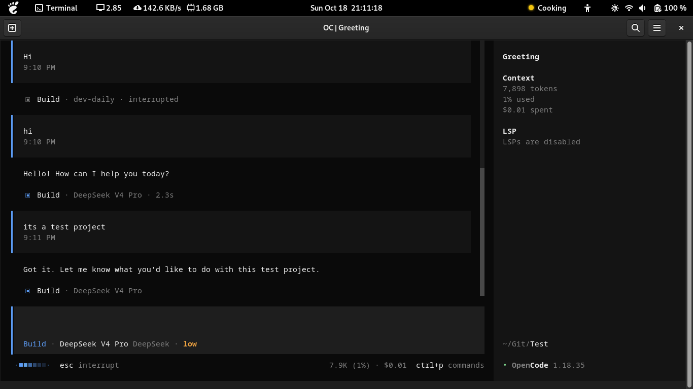
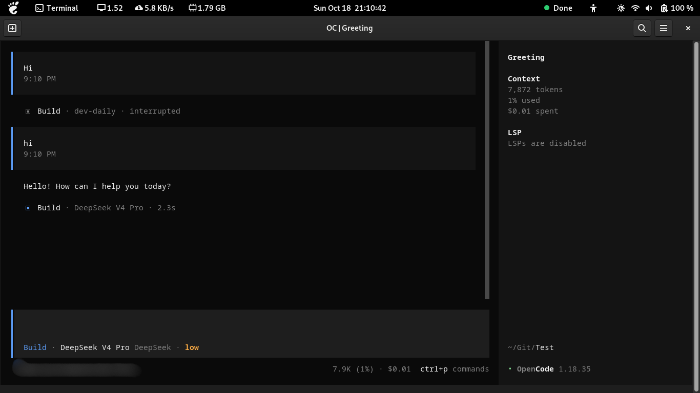
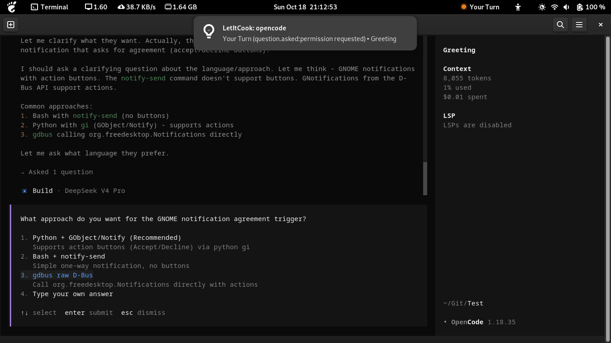

# LetItCook

Attention indicator for AI coding agents running in the terminal.
GNOME Shell top-panel indicator: 🟡Cooking · 🟠Your Turn · 🟢Done · 🔴Burn · ⚪Unknown

LetItCook listens to agent events (an OpenCode plugin, Copilot CLI event logs, Claude Code, Codex CLI and Gemini CLI hooks, and a generic event protocol) and writes normalized session state files to a shared state directory. The GNOME Shell extension reads these files to update the panel indicator and handle notifications.

[](LICENSE)
[](https://nodejs.org/)
[](https://www.gnome.org/)

## What problem does LetItCook solve?

While an AI coding agent works autonomously, you may switch to another activity (browse documentation, read email, use Discord, research, or another coding task). You don't want to repeatedly interrupt your workflow to ask "Is the agent done yet?"

LetItCook answers that question for you without opening the terminal.

## See LetItCook in Action

| Cooking | Done |
|---|---|
| The agent is actively working. | The agent has completed its task successfully. |
|  |  |

### User interaction notifications

When a supported agent requires user interaction, LetItCook can display a GNOME desktop notification explaining the request.



## Supported agents

LetItCook integrates with agents in two ways: **native adapters**, which map an agent's own official hooks or event logs, and the **event protocol**, a generic way for any plugin, wrapper or CLI to report its sessions. Not every integration can report every state. Where an agent gives no reliable signal for a state, LetItCook does not show that state for it and falls back to `Unknown` instead of guessing. See the [status model](#status-model) for what each state means.

### Native adapters

| Agent | State source | How it has been checked |
|---|---|---|
| OpenCode | Official plugin events (`event`, `tool.execute.before/after` hooks) writing to the state dir | Run against the real CLI (including `npm run selftest`) and seen in the panel on GNOME 43 |
| GitHub Copilot CLI | Session-event log replay (`~/.copilot/session-state/*/events.jsonl` + `workspace.yaml`) by `node src/sync.js --watch` | Mapped from the official event schema and replayed against real local session logs |
| Claude Code | Official command hooks (`UserPromptSubmit`, tool, permission, `Stop`/`StopFailure`, subagent and session events) | 🧪 Fixture-tested only; not run against the real CLI or checked in GNOME |
| Codex CLI | Official command hooks (`UserPromptSubmit`, tool, `PermissionRequest`, `Stop`, `Interrupt`, subagent and session events) | 🧪 Fixture-tested only; not run against the real CLI or checked in GNOME |
| Gemini CLI | Official command hooks (`BeforeAgent`, tool events, `Notification`, `AfterAgent`, `SessionEnd`) | 🧪 Fixture-tested only; not run against the real CLI or checked in GNOME |

Which states each adapter can report (every adapter can also fall back to ⚪ Unknown):

| Agent | 🟡 Cooking | 🟠 Your Turn | 🟢 Done | 🔴 Burn |
|---|---|---|---|---|
| OpenCode | ✅ | ✅ Permissions and questions | ✅ Completed reply followed by idle | ✅ `session.error` (a cancelled prompt also shows as Burn) |
| GitHub Copilot CLI | ✅ | ✅ Permissions, input and elicitation requests; also every finished turn | ⚠️ Only on `session.task_complete` with `success: true`, which is rare | ✅ Session errors, failed tasks, shutdown with an error |
| Claude Code | ✅ | ✅ Permissions, questions, elicitations, interrupts | ✅ `Stop` | ✅ `StopFailure` |
| Codex CLI | ✅ | ⚠️ Permissions and interrupts; questions (`request_user_input`) are not shown | ✅ `Stop` | ❌ No hook reports a failed turn |
| Gemini CLI | ✅ | ⚠️ Permissions and questions; also every finished turn, because the end-of-turn hook has no outcome | ❌ | ❌ |

### Event protocol (generic)

The [LetItCook event protocol](docs/protocol.md) is a generic integration mechanism, not a list of supported CLIs. **No third-party CLI has been verified with it yet**; it has been tested with synthetic events and the bundled reference producer. A producer declares which outcomes it can report, and LetItCook ignores outcome events it did not declare. See [Other CLIs: the event protocol](#other-clis-the-event-protocol) under Installation for how to use it.

### Deferred

| Agent | Why |
|---|---|
| Goose | No hook fires while Goose waits for tool approval, and its `Stop` hook has no outcome, so it could show Cooking while it actually needs you. See [docs/adapters.md](docs/adapters.md#goose-deferred). |

See [docs/adapters.md](docs/adapters.md) for how each agent's events map to the states, what each one cannot report, and how adapters are tested. [AGENTS.md §28](AGENTS.md#28-agent-adapter-status) has the per-state reliability notes.

## Installation

### Prerequisites

- **OS / Desktop**: Linux with GNOME Shell 42–47 (see [Project status](#project-status) for which versions have actually been tested)
- **Agent CLI**: One of the supported agents must be installed
- **Node.js**: Version 20.3 or later, needed for the Copilot sync bridge and for running tests (the OpenCode plugin runs inside OpenCode itself)

Check your GNOME Shell version first; it decides which extension variant to install:

```bash
gnome-shell --version
```

### For GNOME Shell 45+ (ESM extension)

```bash
# 1. Obtain the repository
git clone https://github.com/itsfarid/LetItCook.git
cd LetItCook

# 2. Copy files to your extensions directory
mkdir -p ~/.local/share/gnome-shell/extensions/letitcook@letitcook.local
cp extension/* ~/.local/share/gnome-shell/extensions/letitcook@letitcook.local/

# 3. Make GNOME Shell discover the new extension
# X11 session:     Alt + F2 → type: r → Enter
# Wayland session: log out and log back in

# 4. Enable the extension
gnome-extensions enable letitcook@letitcook.local
gnome-extensions info letitcook@letitcook.local   # State should be ENABLED
```

### For GNOME Shell 42–44 (Legacy extension)

Same steps as above, but copy the legacy variant in step 2:

```bash
mkdir -p ~/.local/share/gnome-shell/extensions/letitcook@letitcook.local
cp extension-legacy/* ~/.local/share/gnome-shell/extensions/letitcook@letitcook.local/
```

### OpenCode setup (if using OpenCode)

OpenCode reports state through a LetItCook plugin. Add the plugin's **absolute path inside your clone** to the `plugin` array of your OpenCode config (`~/.config/opencode/opencode.json` or `opencode.jsonc`):

```jsonc
{
  "plugin": [
    "/absolute/path/to/LetItCook/src/adapters/opencode/plugin.js"
  ]
}
```

Reference the file in place rather than copying it: the plugin imports modules from `src/core/`. Restart OpenCode afterwards. Start a prompt; a file should appear in `~/.local/state/letitcook/sessions/`.

### Check that everything works

With the extension enabled and the plugin configured, run the end-to-end self-test:

```bash
npm run selftest -- --model deepseek/deepseek-v4-pro
```

It starts a private, password-protected OpenCode server on `127.0.0.1` in a temporary project. Then it sends one prompt and checks each step: Cooking, then a real permission request (Your Turn), then the GNOME notification, then Cooking again after approval, then Done. It asks whether you saw the popups. It only ever approves the exact command `echo letitcook-selftest`, and it removes the session, server, and temporary project afterwards. Each run makes one short model call. Pressing Ctrl+C (or sending SIGTERM) stops it cleanly: it rejects the pending request, deletes the test session, stops its server, and exits with code 130 (or 143). Without `--model`, it uses your most recent OpenCode model. The Done notification step is skipped unless "Notify on Done" is on.

### Uninstall

```bash
gnome-extensions uninstall letitcook@letitcook.local
```

Then remove the plugin entry from your OpenCode config and the LetItCook entries from your Claude Code and Gemini CLI settings and `~/.codex/hooks.json`, stop any `src/sync.js --watch` process, and optionally delete `~/.local/state/letitcook/`.

### Claude Code setup (if using Claude Code)

Claude Code reports state through [command hooks](https://code.claude.com/docs/en/hooks). Print the settings block for your clone:

```bash
node src/hooks/hook.js --print-config claude
```

Review it, then merge its `hooks` entries into `~/.claude/settings.json`. LetItCook never edits the file for you. Each hook runs `node src/hooks/hook.js claude`, using absolute paths to your Node.js binary and your clone, so keep the clone where it is. The hook prints nothing and always exits 0, so it does not change what Claude Code does. It adds about 70 ms per event. Restart Claude Code (or check with `/hooks`) and start a prompt: a `claude_<session>.json` file should appear in `~/.local/state/letitcook/sessions/`.

To disable it, remove those entries. `"disableAllHooks": true` turns off all hooks. Hooks run with your user's permissions; read the block before adding it.

### Codex CLI setup (if using Codex CLI)

Codex CLI reports state through its [hooks](https://learn.chatgpt.com/docs/hooks). Print the block for your clone:

```bash
node src/hooks/hook.js --print-config codex
```

Review it and merge it into `~/.codex/hooks.json`, creating the file if needed. Then open `/hooks` in Codex and trust the new hooks; Codex does not run them until you do. To disable them, remove the entries or untrust them in `/hooks`. `[features] hooks = false` in `~/.codex/config.toml` turns off all hooks.

### Gemini CLI setup (if using Gemini CLI)

Gemini CLI reports state through its [hooks](https://geminicli.com/docs/hooks/), which are enabled by default. Print the block for your clone:

```bash
node src/hooks/hook.js --print-config gemini
```

Review it and merge its `hooks` entries into `~/.gemini/settings.json`, then restart Gemini CLI. The hooks are named `letitcook-<event>`, so you can disable them with `/hooks disable`, list them under `hooksConfig.disabled`, or remove them.

### Other CLIs: the event protocol

A CLI without a native adapter can report its sessions through the [LetItCook event protocol](docs/protocol.md). This is how a third-party integration plugs in; it does not mean any particular CLI already works with LetItCook.

- **Schema.** Each event is a small JSON object with `schema: 1`, a producer `agent` id, a `session_id`, a unique `event_id`, a `type` such as `turn.started`, `request.opened`, `turn.completed`, `turn.failed`, `turn.cancelled` or `turn.ended`, and a `time`. Events never carry prompts, commands, tool input or output, or credentials.
- **Delivery.** The plugin, wrapper or CLI runs `node src/hooks/hook.js event` with one JSON event (at most 16 KiB) on stdin. The command prints nothing and always exits 0; invalid events are dropped. LetItCook chooses the session file path, never the producer.
- **Capabilities.** A producer declares the outcomes it can actually report (`requests`, `complete`, `fail`, `cancel`). Outcome events it did not declare are ignored. A producer that cannot tell success from failure sends `turn.ended`, which shows Your Turn rather than claiming Done.
- **SDK.** From Node.js, `src/protocol/sdk.js` builds events and applies them in-process through the same code path, and reports whether each event was applied.
- **Validation.** `node src/protocol/validate.js events.jsonl` checks a recording of a producer's events and reports which states it actually produced.

To see what it looks like without any model or API key, run the reference producer and watch the panel:

```bash
node examples/protocol-producer.mjs --scenario permission --keep
```

To remove an integration, stop it from sending events; its sessions disappear when it ends them, when its process exits, or an hour after their last event.

### Copilot CLI setup (if using GitHub Copilot CLI)

Copilot sessions appear in the panel only when `node src/sync.js --watch` (or a systemd timer) runs. Start it once:

```bash
node src/sync.js --watch 5000
```

For persistent operation, run it as a systemd user service or Cron job.

## Configuration and data locations

| Path | Data | Generated / User-editable | Safe to delete |
|---|---|---|---|
| `~/.local/state/letitcook/sessions/` | Session state files (`{session_id}.json`, `copilot_{session_id}.json`, `claude_{session_id}.json`, `codex_{session_id}.json`, `gemini_{session_id}.json`, `@{agent}.{session_id}.json` for the event protocol) | Generated on first start | Sessions are recreated from adapter sources |
| `~/.local/state/letitcook/notify_cache.json` | Notification state (deduplication, notify-on-Done toggle) | Generated on first start | Deleting it resets notification state (opt-out) |
| `~/.copilot/` | Copilot CLI state | Copilot-generated | Do not delete Copilot state unless you want to restart Copilot completely |

The state directories must be owned by you. If `~/.local/state/letitcook` (or its `sessions` directory) is a symlink, it must be your own link to a directory you own that other users cannot access (`chmod 700` it); otherwise LetItCook refuses to use it rather than changing permissions through the link.

**Default paths can be overridden via environment variables:**

- `XDG_STATE_HOME`: Base state directory used by the extension, plugin, sync bridge, and notification tool alike (default: `~/.local/state`)
- `LETITCOOK_STATE_DIR`: Override the sessions directory for the Node.js side only (default: `$XDG_STATE_HOME/letitcook/sessions`). The GNOME extension does not read this variable, so only use it for testing.
- `LETITCOOK_COPILOT_DIR`: Override Copilot home (default: `~/.copilot`)

## Status model

The indicator shows which agent most needs your attention:

| Status | Indicator | Meaning |
|---|---|---|
| Cooking | 🟡 | Agent is actively working (executing tools, streaming messages) |
| Your Turn | 🟠 | Agent requires your input, approval, or permission. Also shown when you cancel a turn, or when a turn ends and the agent does not report whether it succeeded |
| Done | 🟢 | Agent finished successfully, shown only on explicit success evidence from the agent |
| Burn | 🔴 | Agent reported an error or failure. A user cancel is not Burn (except OpenCode, see below) |
| Unknown | ⚪ | Evidence is insufficient, inconsistent, or ambiguous, for example a stale session or an agent process that exited. Never treated as Done |

### Important limitations

- `Unknown` is **not automatically** treated as `Done`. If we cannot reliably determine the state, we postpone the decision.
- `Done` requires explicit session/task-complete events. Idle sessions without prior completion candidates are reported as `Unknown`.
- Any agent disappearance (dead PID, missing state) reveals `Unknown`, never an assumed `Done`. A session whose process has exited is shown as `Unknown` for up to one hour after its last update, then removed from the panel. A session that reached `Done` or `Burn` is removed as soon as its process exits.
- A `Cooking` session with no new state for 5 minutes is shown as `Unknown` (stale). A `Your Turn` session does not time out: a permission prompt or question stays `Your Turn` until it is answered, the session ends, or its process exits (then `Unknown`). A session with no process to watch (Copilot, or a hook that could not determine its agent's process) is removed one hour after its last update, whatever its state.
- Multiple simultaneous sessions: the most urgent/active session determines the panel indicator.

### Known limitations

These describe current behavior and have not all been confirmed in day-to-day use:

- **OpenCode, cancelled prompts**: cancelling a running prompt makes OpenCode emit `session.error` (`MessageAbortedError`), which LetItCook shows as `Burn` and notifies.
- **OpenCode, subagents**: subagent (child) sessions are tracked as separate sessions and can show their own `Done`.
- **OpenCode, long single steps**: while OpenCode keeps emitting events (for example streamed tool output), the plugin refreshes the session at most once a minute, so it stays `Cooking`. A step that runs longer than 5 minutes *without any events* still shows as `Unknown` until the next change.
- **Copilot CLI**: every `assistant.turn_end` maps to `Your Turn`, so each finished turn notifies. `Done` requires `session.task_complete`, which is rare.
- **Copilot CLI**: state only updates while `node src/sync.js --watch` is running.
- **Claude Code**: pressing Esc while the model is thinking (no tool running) fires no hook, so the session stays `Cooking` and becomes `Unknown` after 5 minutes. Esc while a tool runs shows `Your Turn`.
- **Claude Code**: denying a permission in the dialog fires no hook. The session stays `Your Turn` (the turn has stopped) until your next prompt.
- **Codex CLI**: no hook reports a failed turn, so a turn that errors stays `Cooking` and becomes `Unknown` after 5 minutes; it is never `Burn`. Questions (`request_user_input`) are not shown as `Your Turn`.
- **Gemini CLI**: Gemini's end-of-turn hook does not say whether the turn succeeded, so every finished turn shows `Your Turn` and notifies. Gemini sessions are never `Done` or `Burn`.
- **Copilot CLI**: Copilot records no process id, so the sync bridge stops showing a session (including `Your Turn`) one hour after its last event. Only `Cooking` sessions are kept longer, until they go stale.

## Notifications

GNOME desktop notifications are handled exclusively by the extension. States that trigger notifications:

| State | Notified automatically | Can opt out |
|---|---|---|
| Your Turn | ✅ Yes | No |
| Burn | ✅ Yes | No |
| Done | ❌ Off by default | Opt in with the "Notify on Done" switch in the panel menu (persisted in `notify_cache.json`) |
| Cooking / Unknown | ❌ No | Not applicable |

Notification deduplication uses `notify_cache.json` to prevent duplicate alerts across:
- State file writes
- Poll intervals
- Extension reloads

Verification:

```bash
node src/notify.js                # - Reads current sessions (read-only)
node src/notify.js --include-done  # - Include Done transitions in inspection
node src/notify.js --test          # - Send one manual test notification via notify-send
```

## Architecture

### Event flow

```
┌─────────────────┐
│  OpenCode CLI   │
│  Copilot CLI    │
│  Claude Code    │
│  Codex CLI      │
│  Gemini CLI     │
│  Protocol       │
│  producers      │
└────────┬────────┘
         │ (events, logs)
         ▼
┌─────────────────┐
│ Agent Adapter / │
│ hook bridge     │
│ (src/adapters/, │
│  src/hooks/)    │
└────────┬────────┘
         │ (normalized session JSON)
         ▼
┌─────────────────┐
│ State Directory │
│ ~/.local/state/ │
│ letitcook/      │
│ sessions/       │
└────────┬────────┘
         │ (file system monitor + polling)
         ▼
┌─────────────────┐
│ GNOME Shell     │
│ Extension       │
│ (extension/,    │
│  -extension.js) │
└────────┬────────┘
         │ (top panel indicator + popup menu)
         ▼
┌─────────────────┐
│  User Interface │
└─────────────────┘
```

### Implementation notes

- OpenCode writes state files directly via its plugin hooks (`event`, `tool.execute.before/after`). No CLI bridge needed.
- Claude Code, Codex CLI and Gemini CLI run `node src/hooks/hook.js <agent>` for each hook event. The shared hook bridge maps the event through the adapter and the shared lifecycle contract into the state directory (see [docs/adapters.md](docs/adapters.md)).
- Copilot CLI is poll-based. `node src/sync.js` repeatedly replays its session-event log into the state directory. The Copilot adapter cannot push; the polling script bridges to the shared state dir.
- GNOME monitors state directory changes (directory monitor) and falls back to periodic polling (2-second interval).
- Notifications are evaluated per-session with state transitions (from last-seen status).
- Filesystem hardening: state directories are created with mode 0700, and session files and the notification cache with mode 0600. The notification cache additionally rejects symlinks, hard links, and files owned by other users.

## Development setup

### Prerequisite checks

```bash
# Verify Node.js
node --version  # Should be >= 20.3

# Verify GNOME Shell (if testing directly)
gnome-shell --version
```

### Install dependencies

No external dependencies required (uses only Node.js standard library and GJS built-ins). Still:

```bash
npm install  # (no packages installed; kept for potential future additions)
```

### Run tests

```bash
npm test
```

Runs 23 test files covering:

- State normalization and aggregation
- Adapter contract, adapter conformance and session discovery
- The shared lifecycle contract and hook bridge
- Copilot session/event mapping
- OpenCode event/tool-hook mapping
- Claude Code, Codex CLI and Gemini CLI hook mapping (synthetic fixtures)
- Event protocol: schema, adapter, SDK, validator and reference producer
- Integration scenarios (OpenCode plugin, Copilot polling)
- Filesystem operations and hardening
- Notification eligibility and deduplication
- Performance (debouncing, syslog bursts)
- Lifecycle behavior (start/stop/reload)
- GNOME extension compatibility

Each command is an independent test. Ready-to-run assertions are included in every file; manual verification required only for GUI state changes.

### Development workflow

1. **Editable files**: only `extension/*`, `extension-legacy/*`, `src/*`, `test/*`. No build step.

2. **Test after change**:

   ```bash
   npm test                  # Full suite
   node test/test-state.js        # State normalization
   node test/test-copilot.js      # Copilot adapter
   node test/test-plugin.js    # OpenCode plugin integration
   ```

3. **Reload the GNOME extension** after editing it. Copy the variant that matches your GNOME version (`extension/` for 45+, `extension-legacy/` for 42–44), then restart GNOME Shell. On X11, press Alt + F2, type `r`, and press Enter. On Wayland, log out and back in. `gnome-extensions` has no reload command.

   ```bash
   cp extension-legacy/* ~/.local/share/gnome-shell/extensions/letitcook@letitcook.local/
   ```

   Extension errors are written to the journal:

   ```bash
   journalctl --user -b -g LetItCook
   ```

4. **GUI validation**: open extension dropdown, observe indicator, check popup menu and notifications.

### Tool reference

| Command | Purpose |
|---|---|
| `npm test` | Run all test suites |
| `node src/sync.js` | One-shot sync Copilot sessions into state dir |
| `node src/sync.js --watch [ms]` | Poll Copilot every `[ms]` (default ping 5000) |
| `node src/notify.js` | Inspect notification transitions (read-only) |
| `node src/notify.js --include-done` | Include Done transitions in inspection |
| `node src/notify.js --test [status]` | Send manual test notification via `notify-send` (tests desktop delivery only, not the extension) |
| `npm run selftest -- [--model provider/model] [--no-ask]` | End-to-end OpenCode check: permission request, notification, status changes |
| `node src/notify.js --dispatch` | Refused (deprecated; causes race conditions) |

## Troubleshooting

### "Extension not appearing or not enabled"

- **Cause**: Copied files to wrong directory or GNOME Extensions app disabled it.
- **Check**:
  ```bash
  ls -la ~/.local/share/gnome-shell/extensions/letitcook@letitcook.local/
  ```
- **Fix**: confirm the directory name is exactly `letitcook@letitcook.local` and that the variant matches your GNOME version. Restart GNOME Shell (X11: Alt + F2 → `r`; Wayland: log out and back in), then run `gnome-extensions enable letitcook@letitcook.local`. Check `journalctl --user -b -g LetItCook` for load errors. Do not run `killall gnome-shell` on Wayland, because it ends your whole session.

### Indicator stuck at 🟡 or ⚪

- **Cause**: Agent adapter has no recent events or state files are stale. OpenCode: missing plugin hooks; Copilot: no sessions in `~/.copilot/session-state/`.
- **Check**:
  ```bash
  node src/notify.js  # printed events/count
  ls ~/.local/state/letitcook/sessions/
  ls ~/.copilot/session-state/
  ```
- **Fix**: Start the agent again; verify Copilot `src/sync.js` is running if using Copilot.

### "Done" not appearing after task completes

- **No Done popup**: Done notifications are off by default. Turn on "Notify on Done" in the panel menu. A Done popup appears only for a direct `Cooking` → `Done` transition.
- **Indicator shows Unknown instead of Done**: `Done` requires explicit completion evidence. For OpenCode, that is a completed assistant reply to the latest user message that ends without tool calls or errors, followed by the session going idle. For Copilot, it is `session.task_complete` with `success: true`. An idle session without that evidence is shown as `Unknown`.
- **Check**:
  ```bash
  node src/notify.js --include-done
  ls ~/.local/state/letitcook/sessions/
  ```

### Notification missing for Your Turn / Burn

- **Cause**: GNOME Do Not Disturb is on, the cache already records this status as notified, or the notification cache failed its ownership/permission checks and is ignored.
- **Check**:
  ```bash
  ls -l ~/.local/state/letitcook/notify_cache.json   # expect -rw------- owned by you
  node src/notify.js
  journalctl --user -b -g LetItCook
  ```
- **Fix**: Turn off Do Not Disturb. If the cache looks wrong, delete `notify_cache.json`; this also resets the "Notify on Done" switch. Notifications are sent by GNOME Shell itself, so `notify-send` is needed only for `node src/notify.js --test`.

### Agent adapter not loading or OpenCode plugin nonexistent

- **Cause**: Agent not installed, or the plugin path is missing or wrong in the OpenCode config.
- **Check**:
  ```bash
  which opencode copilot
  grep -n -A3 '"plugin"' ~/.config/opencode/opencode.json*
  ```
- **Fix**: Install the agent CLI. Make sure the `plugin` entry is the absolute path to `src/adapters/opencode/plugin.js` in your clone, then restart OpenCode. If you set `LETITCOOK_STATE_DIR` for OpenCode, unset it, because the GNOME extension does not read that variable.

### Modern/legacy compatibility failing

- **Cause**: Running ESM extension on GNOME 42–44 or vice versa.
- **Check**:
  ```bash
  gnome-shell --version
  ls ~/.local/share/gnome-shell/extensions/letitcook@letitcook.local/metadata.json
  cat ~/.local/share/gnome-shell/extensions/letitcook@letitcook.local/metadata.json | grep -E '"shell-version"'
  ```
- **Fix**: Install the matching variant (`extension/` for GNOME 45+, `extension-legacy/` for 42–44).

### Stale session state or duplicate notifications

- **Cause**: Session files from agents that are no longer running. Sessions whose process has exited are removed automatically one hour after their last update.
- **Fix**: Use **Clear Inactive Sessions** in the panel menu to remove `Done`, `Unknown`, and stale sessions now. To reset notification deduplication, delete `~/.local/state/letitcook/notify_cache.json`. This also resets the "Notify on Done" switch.

## Security and privacy

- All code is local-first. No network requests, telemetry, or cloud sync.
- Session state files and the notification cache are stored with restricted permissions (0600 for files, 0700 for directories).
- Input validation: session IDs are sanitized (regex `[A-Za-z0-9][A-Za-z0-9._-]{0,127}`), file paths are validated, shell commands are avoided.
- Logging never prints prompts, credentials, or sensitive agent messages. Structured agents and plugins must sanitize outputs before passing state to LetItCook.
- GNOME extension notifications are delivered via the native GNOME notification system; no CLI dispatch to avoid race conditions.
- Notification and panel-menu text is reduced to one short line (at most the first 512 characters of an agent's message are examined). A Your Turn notification names only the kind of request (for example `permission.asked:bash`), never the command or its arguments. Error text in a Burn notification keeps only its first line, with credentials redacted, URLs reduced to their host, and absolute paths reduced to their last component.
- No external dependencies. If new dependencies are added, only standard Node.js and safe open-source packages should be used.

## Project status

- **Published?**: No. Local installation only.
- **Declared GNOME versions**: 42–44 (`extension-legacy/`) and 45–47 (`extension/`). Only GNOME 43 (legacy variant, Wayland) has been used on a real desktop. The ESM variant passes syntax, packaging, and mocked behavior tests but has not been run in a real GNOME 45–47 session.
- **Native adapters**: OpenCode and GitHub Copilot CLI have been checked against the real agents. Claude Code, Codex CLI and Gemini CLI are implemented and fixture-tested only; Codex never reports Burn, and Gemini never reports Done or Burn.
- **Event protocol**: implemented (schema 1) and tested with the reference producer only; no third-party CLI verified.
- **Deferred**: Goose.
- **Development focus**: Personal workflow validation. No roadmap promises.

## License

MIT

---

For development guidelines, contributing workflow, and agent adapter design principles, see [CONTRIBUTING.md](CONTRIBUTING.md). For lifecycle, status semantics, and security notes, see [AGENTS.md](AGENTS.md).